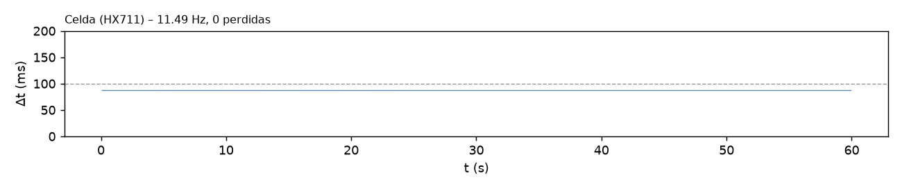

# T-INT2 – Adquisición simultánea (int2_20261109_155940)

Análisis generado el 09/11/2026 16:00. Duración registrada: 59.9 s (reloj del ESP32).

## Configuración e inicio

- `baud=115200`, `tof_periodo_ms=50`, `tof_budget_us=50000`, `imu_periodo_ms=100`, `hx711_sps_esperado=10`, `i2c_wire_hz=100000`, `i2c_wire1_hz=100000`
- `SCAN Wire (GPIO21/22, ToF): (ninguno) -> esperado 0x29 0x30 : FALTA`
- `SCAN Wire1 (GPIO17/16, BNO055): (ninguno) -> esperado 0x28 : FALTA`
- `INIT HX711=OK ToF1=FALLA ToF2=FALLA BNO055=FALLA`
- `CAL HX711 tara=1 calibrado=1 escala_N_por_cuenta=0.00024704`

## Criterios (5/8 cumplen)

Criterios propuestos para T-INT2 (ajustables en el script).

| Criterio | Resultado | Detalle |
|---|---|---|
| Lineas perdidas en el Serial = 0 | **CUMPLE** | 0 perdidas, 0 malformadas |
| Buffer del Serial sin bloqueos | **CUMPLE** | serialBloq = 0 |
| Celda (HX711): frecuencia real (informativo) | **INFO** | 11.49 Hz (nominal del modulo 10 Hz); dt std 0.01 ms |
| Celda (HX711): muestras perdidas <= 0.1 % | **CUMPLE** | 0 (0.000 %) en 0 huecos |
| Celda (HX711): sin errores | **CUMPLE** | 0 errores |
| ToF1 (U3, 0x30): entrega datos | **NO CUMPLE** | 0 muestras |
| ToF2 (U2, 0x29): entrega datos | **NO CUMPLE** | 0 muestras |
| IMU (BNO055): entrega datos | **NO CUMPLE** | 0 muestras |
| Celda sin congelamiento ni saturacion | **CUMPLE** | racha identica 0.2 s, 0 muestras saturadas |

## Frecuencia real e intervalos

| Sensor | Muestras | Generadas (ESP32) | f real (Hz) | f nominal (Hz) | Δt mediana (ms) | Δt std (ms) | Δt mín / p99 / máx (ms) | Huecos | Perdidas est. |
|---|---|---|---|---|---|---|---|---|---|
| Celda (HX711) | 690 | 689 | 11.493 | 10.00 | 87.01 | 0.01 | 87.0 / 87.0 / 87.0 | 0 | 0 (0.000 %) |
| ToF1 (U3, 0x30) | 0 | 0 | – | 20.00 | – | – | – | – | – |
| ToF2 (U2, 0x29) | 0 | 0 | – | 20.00 | – | – | – | – | – |
| IMU (BNO055) | 0 | 0 | – | 10.00 | – | – | – | – | – |

Un hueco es un intervalo mayor que 1.5× la mediana; las muestras perdidas se estiman como round(Δt / mediana) − 1 en cada hueco. Si «Generadas» supera a «Muestras», la diferencia se perdió en el enlace Serial y no en el sensor.

## Errores y conflictos en el bus

- Líneas perdidas en el Serial (saltos del contador n): 0; líneas malformadas: 0; reinicios/desorden del contador: 0
- Bloqueos del buffer del Serial (serialBloq): 0
- Duración máxima del loop por segundo: mediana 259 µs, p99 270 µs, máx 277 µs
- Errores acumulados en el ESP32: HX711 0, ToF1 0, ToF2 0, BNO055 0

## Detalle por sensor

- HX711 – racha más larga de cuentas idénticas: 0.2 s; muestras saturadas: 0

