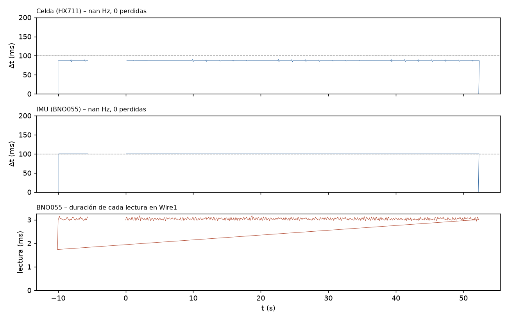

# T-INT2 – Adquisición simultánea (int2_20261109_162634)

Análisis generado el 09/11/2026 16:27. Duración registrada: -5.6 s (reloj del ESP32).

## Configuración e inicio

- `baud=115200`, `tof_periodo_ms=50`, `tof_budget_us=50000`, `imu_periodo_ms=100`, `hx711_sps_esperado=10`, `i2c_wire_hz=100000`, `i2c_wire1_hz=100000`
- `SCAN Wire (GPIO21/22, ToF): (ninguno) -> esperado 0x29 0x30 : FALTA`
- `SCAN Wire1 (GPIO16/4, BNO055): 0x28 -> esperado 0x28 : OK`
- `INIT HX711=OK ToF1=FALLA ToF2=FALLA BNO055=OK`
- `CAL HX711 tara=1 calibrado=1 escala_N_por_cuenta=0.00024704`

## Criterios (6/11 cumplen)

Criterios propuestos para T-INT2 (ajustables en el script).

| Criterio | Resultado | Detalle |
|---|---|---|
| Lineas perdidas en el Serial = 0 | **NO CUMPLE** | 0 perdidas, 11 malformadas |
| Buffer del Serial sin bloqueos | **CUMPLE** | serialBloq = 0 |
| Celda (HX711): frecuencia real (informativo) | **INFO** | nan Hz (nominal del modulo 10 Hz); dt std 2443.21 ms |
| Celda (HX711): muestras perdidas <= 0.1 % | **CUMPLE** | 0 (0.000 %) en 0 huecos |
| Celda (HX711): sin errores | **CUMPLE** | 0 errores |
| ToF1 (U3, 0x30): entrega datos | **NO CUMPLE** | 0 muestras |
| ToF2 (U2, 0x29): entrega datos | **NO CUMPLE** | 0 muestras |
| IMU (BNO055): frecuencia dentro de +-5 % de la nominal | **NO CUMPLE** | nan Hz vs 10.00 Hz (+nan %) |
| IMU (BNO055): muestras perdidas <= 0.1 % | **CUMPLE** | 0 (0.000 %) en 0 huecos |
| IMU (BNO055): sin errores | **CUMPLE** | 0 errores |
| IMU sin congelamientos (>= 10 s identico) | **REVISAR** | racha mas larga 52.3 s (un IMU muy quieto puede repetir valores: si sale REVISAR, mover levemente la plataforma y ver si responde) |
| Celda sin congelamiento ni saturacion | **CUMPLE** | racha identica 0.2 s, 0 muestras saturadas |

## Frecuencia real e intervalos

| Sensor | Muestras | Generadas (ESP32) | f real (Hz) | f nominal (Hz) | Δt mediana (ms) | Δt std (ms) | Δt mín / p99 / máx (ms) | Huecos | Perdidas est. |
|---|---|---|---|---|---|---|---|---|---|
| Celda (HX711) | 655 | 46 | nan | 10.00 | 86.97 | 2443.21 | -62442.2 / 89.5 / 90.3 | 0 | 0 (0.000 %) |
| ToF1 (U3, 0x30) | 0 | 0 | – | 20.00 | – | – | – | – | – |
| ToF2 (U2, 0x29) | 0 | 0 | – | 20.00 | – | – | – | – | – |
| IMU (BNO055) | 570 | 41 | nan | 10.00 | 100.00 | 2617.69 | -62396.7 / 100.0 / 100.1 | 0 | 0 (0.000 %) |

Un hueco es un intervalo mayor que 1.5× la mediana; las muestras perdidas se estiman como round(Δt / mediana) − 1 en cada hueco. Si «Generadas» supera a «Muestras», la diferencia se perdió en el enlace Serial y no en el sensor.

## Errores y conflictos en el bus

- Líneas perdidas en el Serial (saltos del contador n): 0; líneas malformadas: 11; reinicios/desorden del contador: 1
- Bloqueos del buffer del Serial (serialBloq): 0
- Duración máxima del loop por segundo: mediana 3338 µs, p99 3477 µs, máx 3554 µs
- Errores acumulados en el ESP32: HX711 0, ToF1 0, ToF2 0, BNO055 0

## Detalle por sensor

- BNO055 – duración de cada lectura (calib + Euler, Wire1): media 3037 µs, p99 3123 µs, máx 3179 µs; lecturas fallidas: 0
- BNO055 – calibración [sys,gyr,acc,mag] final [0, 0, 0, 0], mínima durante el registro [0, 0, 0, 0]
- BNO055 – racha más larga de roll/pitch/heading idénticos: 52.3 s (desde t = 0.0 s)
- HX711 – racha más larga de cuentas idénticas: 0.2 s; muestras saturadas: 0

