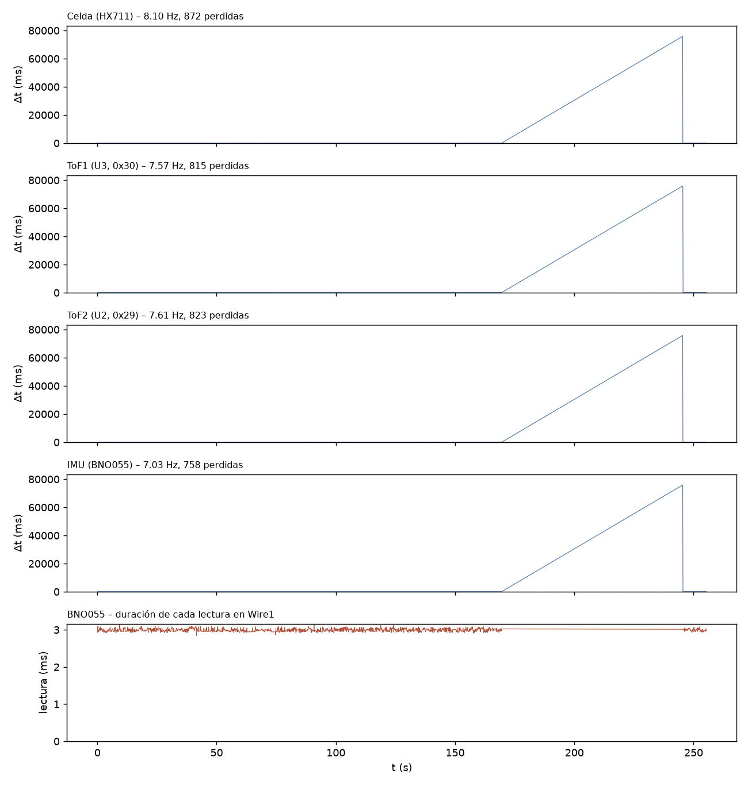

# T-INT2 – Adquisición simultánea (int2_20261109_175554)

Análisis generado el 09/11/2026 19:18. Duración registrada: 255.3 s (reloj del ESP32).

## Configuración e inicio

- `baud=115200`, `tof_periodo_ms=50`, `tof_budget_us=50000`, `imu_periodo_ms=100`, `hx711_sps_esperado=10`, `i2c_wire_hz=100000`, `i2c_wire1_hz=100000`
- `SCAN Wire (GPIO21/22, ToF): 0x29 0x30 -> esperado 0x29 0x30 : OK`
- `SCAN Wire1 (GPIO16/4, BNO055): 0x28 -> esperado 0x28 : OK`
- `INIT HX711=OK ToF1=OK ToF2=OK BNO055=OK`
- `CAL HX711 tara=1 calibrado=1 escala_N_por_cuenta=0.00024704`

## Criterios (6/15 cumplen)

Criterios propuestos para T-INT2 (ajustables en el script).

| Criterio | Resultado | Detalle |
|---|---|---|
| Lineas perdidas en el Serial = 0 | **NO CUMPLE** | 3342 perdidas, 1 malformadas |
| Buffer del Serial sin bloqueos | **CUMPLE** | serialBloq = 0 |
| Celda (HX711): frecuencia real (informativo) | **INFO** | 8.10 Hz (nominal del modulo 10 Hz); dt std 1665.69 ms |
| Celda (HX711): muestras perdidas <= 0.1 % | **NO CUMPLE** | 872 (29.660 %) en 1 huecos |
| Celda (HX711): sin errores | **CUMPLE** | 0 errores |
| ToF1 (U3, 0x30): frecuencia dentro de +-5 % de la nominal | **NO CUMPLE** | 7.57 Hz vs 20.00 Hz (-62.1 %) |
| ToF1 (U3, 0x30): muestras perdidas <= 0.1 % | **NO CUMPLE** | 815 (29.647 %) en 1 huecos |
| ToF1 (U3, 0x30): sin errores | **CUMPLE** | 0 errores |
| ToF2 (U2, 0x29): frecuencia dentro de +-5 % de la nominal | **NO CUMPLE** | 7.61 Hz vs 20.00 Hz (-62.0 %) |
| ToF2 (U2, 0x29): muestras perdidas <= 0.1 % | **NO CUMPLE** | 823 (29.754 %) en 1 huecos |
| ToF2 (U2, 0x29): sin errores | **CUMPLE** | 0 errores |
| IMU (BNO055): frecuencia dentro de +-5 % de la nominal | **NO CUMPLE** | 7.03 Hz vs 10.00 Hz (-29.7 %) |
| IMU (BNO055): muestras perdidas <= 0.1 % | **NO CUMPLE** | 758 (29.679 %) en 1 huecos |
| IMU (BNO055): sin errores | **CUMPLE** | 0 errores |
| IMU sin congelamientos (>= 10 s identico) | **REVISAR** | racha mas larga 255.3 s (un IMU muy quieto puede repetir valores: si sale REVISAR, mover levemente la plataforma y ver si responde) |
| Celda sin congelamiento ni saturacion | **CUMPLE** | racha identica 0.1 s, 0 muestras saturadas |

## Frecuencia real e intervalos

| Sensor | Muestras | Generadas (ESP32) | f real (Hz) | f nominal (Hz) | Δt mediana (ms) | Δt std (ms) | Δt mín / p99 / máx (ms) | Huecos | Perdidas est. |
|---|---|---|---|---|---|---|---|---|---|
| Celda (HX711) | 2068 | 2935 | 8.096 | 10.00 | 86.87 | 1665.69 | 78.0 / 91.0 / 75834.7 | 1 | 872 (29.660 %) |
| ToF1 (U3, 0x30) | 1934 | 2746 | 7.573 | 20.00 | 93.00 | 1724.46 | 87.8 / 97.0 / 75930.0 | 1 | 815 (29.647 %) |
| ToF2 (U2, 0x29) | 1943 | 2757 | 7.608 | 20.00 | 92.00 | 1717.87 | 84.4 / 97.0 / 75815.0 | 1 | 823 (29.754 %) |
| IMU (BNO055) | 1796 | 2550 | 7.031 | 10.00 | 100.00 | 1788.61 | 92.3 / 103.3 / 75900.0 | 1 | 758 (29.679 %) |

Un hueco es un intervalo mayor que 1.5× la mediana; las muestras perdidas se estiman como round(Δt / mediana) − 1 en cada hueco. Si «Generadas» supera a «Muestras», la diferencia se perdió en el enlace Serial y no en el sensor.

Huecos más largos:

- Celda (HX711): t = 169.57 s, Δt = 75834.7 ms
- ToF1 (U3, 0x30): t = 169.56 s, Δt = 75930.0 ms
- ToF2 (U2, 0x29): t = 169.61 s, Δt = 75815.0 ms
- IMU (BNO055): t = 169.54 s, Δt = 75900.0 ms

## Errores y conflictos en el bus

- Líneas perdidas en el Serial (saltos del contador n): 3342; líneas malformadas: 1; reinicios/desorden del contador: 0
- Bloqueos del buffer del Serial (serialBloq): 0
- Duración máxima del loop por segundo: mediana 7787 µs, p99 11134 µs, máx 11181 µs
- Errores acumulados en el ESP32: HX711 0, ToF1 0, ToF2 0, BNO055 0

## Detalle por sensor

- ToF1 – estado de rango: RangeValid 100.0 %
- ToF2 – estado de rango: RangeValid 100.0 %
- BNO055 – duración de cada lectura (calib + Euler, Wire1): media 2993 µs, p99 3084 µs, máx 3146 µs; lecturas fallidas: 0
- BNO055 – calibración [sys,gyr,acc,mag] final [0, 0, 0, 0], mínima durante el registro [0, 0, 0, 0]
- BNO055 – racha más larga de roll/pitch/heading idénticos: 255.3 s (desde t = 0.0 s)
- HX711 – racha más larga de cuentas idénticas: 0.1 s; muestras saturadas: 0

