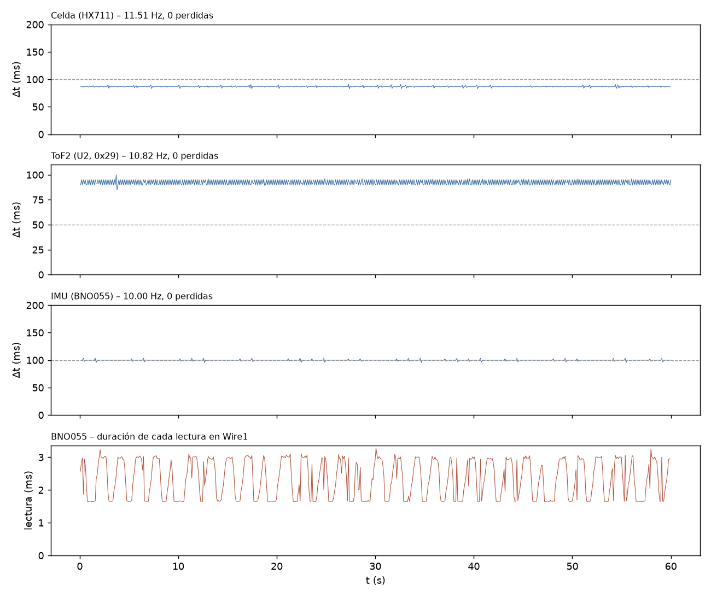

# T-INT2 – Adquisición simultánea (int2_20261110_153701)

Análisis generado el 10/11/2026 15:38. Duración registrada: 60.0 s (reloj del ESP32).

## Configuración e inicio

## Criterios (9/13 cumplen)

Criterios propuestos para T-INT2 (ajustables en el script).

| Criterio | Resultado | Detalle |
|---|---|---|
| Lineas perdidas en el Serial = 0 | **CUMPLE** | 0 perdidas, 0 malformadas |
| Buffer del Serial sin bloqueos | **CUMPLE** | serialBloq = 0 |
| Celda (HX711): frecuencia real (informativo) | **INFO** | 11.51 Hz (nominal del modulo 10 Hz); dt std 0.96 ms |
| Celda (HX711): muestras perdidas <= 0.1 % | **CUMPLE** | 0 (0.000 %) en 0 huecos |
| Celda (HX711): sin errores | **CUMPLE** | 0 errores |
| ToF1 (U3, 0x30): entrega datos | **NO CUMPLE** | 0 muestras |
| ToF2 (U2, 0x29): frecuencia dentro de +-5 % de la nominal | **NO CUMPLE** | 10.82 Hz vs 20.00 Hz (-45.9 %) |
| ToF2 (U2, 0x29): muestras perdidas <= 0.1 % | **CUMPLE** | 0 (0.000 %) en 0 huecos |
| ToF2 (U2, 0x29): sin errores | **NO CUMPLE** | 4 errores |
| IMU (BNO055): frecuencia dentro de +-5 % de la nominal | **CUMPLE** | 10.00 Hz vs 10.00 Hz (+0.0 %) |
| IMU (BNO055): muestras perdidas <= 0.1 % | **CUMPLE** | 0 (0.000 %) en 0 huecos |
| IMU (BNO055): sin errores | **CUMPLE** | 0 errores |
| IMU sin congelamientos (>= 10 s identico) | **REVISAR** | racha mas larga 13.5 s (un IMU muy quieto puede repetir valores: si sale REVISAR, mover levemente la plataforma y ver si responde) |
| Celda sin congelamiento ni saturacion | **CUMPLE** | racha identica 0.1 s, 0 muestras saturadas |

## Frecuencia real e intervalos

| Sensor | Muestras | Generadas (ESP32) | f real (Hz) | f nominal (Hz) | Δt mediana (ms) | Δt std (ms) | Δt mín / p99 / máx (ms) | Huecos | Perdidas est. |
|---|---|---|---|---|---|---|---|---|---|
| Celda (HX711) | 691 | 689 | 11.513 | 10.00 | 86.85 | 0.96 | 82.6 / 90.0 / 91.1 | 0 | 0 (0.000 %) |
| ToF1 (U3, 0x30) | 0 | 0 | – | 20.00 | – | – | – | – | – |
| ToF2 (U2, 0x29) | 650 | 647 | 10.818 | 20.00 | 91.00 | 2.48 | 85.0 / 96.0 / 100.0 | 0 | 0 (0.000 %) |
| IMU (BNO055) | 600 | 598 | 10.000 | 10.00 | 100.00 | 0.94 | 95.7 / 103.3 / 103.3 | 0 | 0 (0.000 %) |

Un hueco es un intervalo mayor que 1.5× la mediana; las muestras perdidas se estiman como round(Δt / mediana) − 1 en cada hueco. Si «Generadas» supera a «Muestras», la diferencia se perdió en el enlace Serial y no en el sensor.

## Errores y conflictos en el bus

- Líneas perdidas en el Serial (saltos del contador n): 0; líneas malformadas: 0; reinicios/desorden del contador: 0
- Bloqueos del buffer del Serial (serialBloq): 0
- Duración máxima del loop por segundo: mediana 6270 µs, p99 7634 µs, máx 7635 µs
- Errores acumulados en el ESP32: HX711 0, ToF1 11944, ToF2 4, BNO055 0
  - ToF1 / i2c: 120 línea(s) E (se imprime como máximo una cada 500 ms por sensor)
  - ToF2 / i2c: 4 línea(s) E (se imprime como máximo una cada 500 ms por sensor)

## Detalle por sensor

- ToF2 – estado de rango: 255 100.0 %
- BNO055 – duración de cada lectura (calib + Euler, Wire1): media 2329 µs, p99 3086 µs, máx 3275 µs; lecturas fallidas: 0
- BNO055 – calibración [sys,gyr,acc,mag] final [0, 3, 1, 0], mínima durante el registro [0, 3, 1, 0]
- BNO055 – racha más larga de roll/pitch/heading idénticos: 13.5 s (desde t = 34.1 s)
- HX711 – racha más larga de cuentas idénticas: 0.1 s; muestras saturadas: 0

