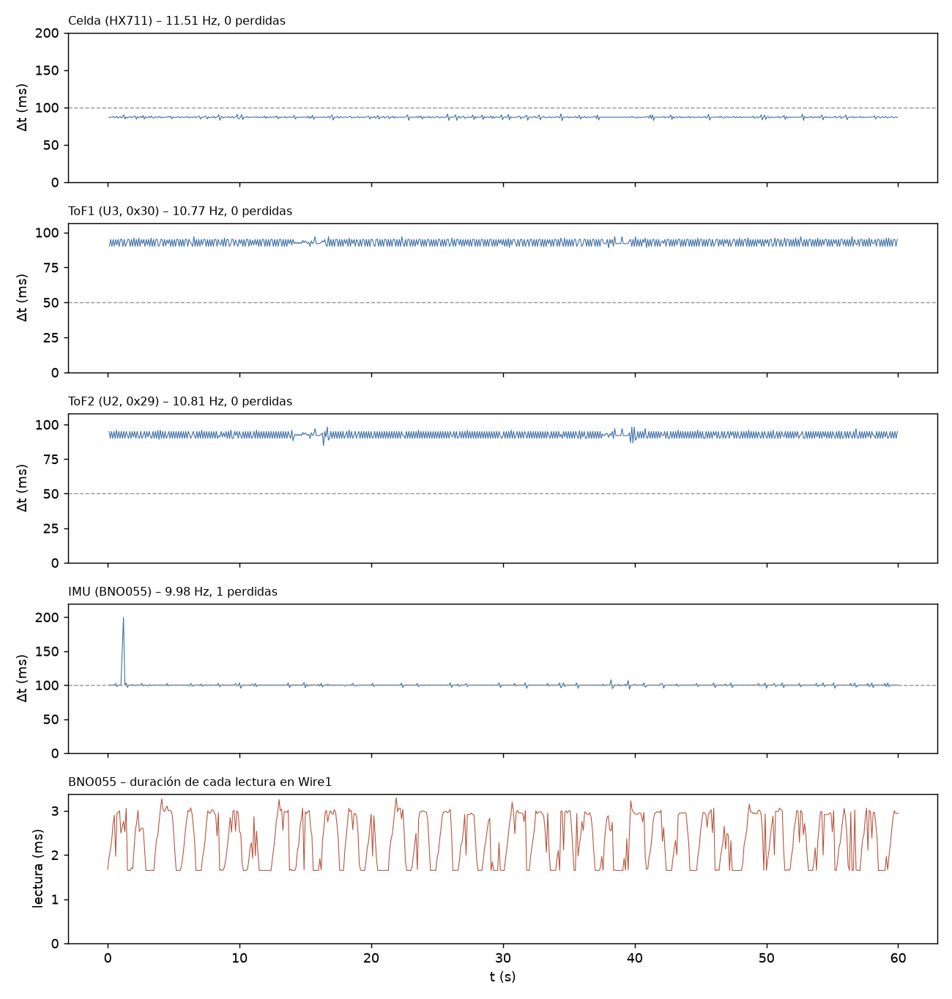

# T-INT2 – Adquisición simultánea (int2_20261110_154946)

Análisis generado el 10/11/2026 15:50. Duración registrada: 60.0 s (reloj del ESP32).

## Configuración e inicio

- `baud=115200`, `tof_periodo_ms=50`, `tof_budget_us=50000`, `imu_periodo_ms=100`, `hx711_sps_esperado=10`, `i2c_wire_hz=100000`, `i2c_wire1_hz=100000`
- `SCAN Wire (GPIO21/22, ToF): 0x29 0x30 -> esperado 0x29 0x30 : OK`
- `SCAN Wire1 (GPIO17/16, BNO055): 0x28 -> esperado 0x28 : OK`
- `INIT HX711=OK ToF1=OK ToF2=OK BNO055=OK`
- `CAL HX711 tara=1 calibrado=1 escala_N_por_cuenta=0.00024704`

## Criterios (10/15 cumplen)

Criterios propuestos para T-INT2 (ajustables en el script).

| Criterio | Resultado | Detalle |
|---|---|---|
| Lineas perdidas en el Serial = 0 | **NO CUMPLE** | 1 perdidas, 1 malformadas |
| Buffer del Serial sin bloqueos | **CUMPLE** | serialBloq = 0 |
| Celda (HX711): frecuencia real (informativo) | **INFO** | 11.51 Hz (nominal del modulo 10 Hz); dt std 1.20 ms |
| Celda (HX711): muestras perdidas <= 0.1 % | **CUMPLE** | 0 (0.000 %) en 0 huecos |
| Celda (HX711): sin errores | **CUMPLE** | 0 errores |
| ToF1 (U3, 0x30): frecuencia dentro de +-5 % de la nominal | **NO CUMPLE** | 10.77 Hz vs 20.00 Hz (-46.1 %) |
| ToF1 (U3, 0x30): muestras perdidas <= 0.1 % | **CUMPLE** | 0 (0.000 %) en 0 huecos |
| ToF1 (U3, 0x30): sin errores | **CUMPLE** | 0 errores |
| ToF2 (U2, 0x29): frecuencia dentro de +-5 % de la nominal | **NO CUMPLE** | 10.81 Hz vs 20.00 Hz (-45.9 %) |
| ToF2 (U2, 0x29): muestras perdidas <= 0.1 % | **CUMPLE** | 0 (0.000 %) en 0 huecos |
| ToF2 (U2, 0x29): sin errores | **NO CUMPLE** | 1 errores |
| IMU (BNO055): frecuencia dentro de +-5 % de la nominal | **CUMPLE** | 9.98 Hz vs 10.00 Hz (-0.2 %) |
| IMU (BNO055): muestras perdidas <= 0.1 % | **NO CUMPLE** | 1 (0.166 %) en 1 huecos |
| IMU (BNO055): sin errores | **CUMPLE** | 0 errores |
| IMU sin congelamientos (>= 10 s identico) | **CUMPLE** | racha mas larga 9.7 s (un IMU muy quieto puede repetir valores: si sale REVISAR, mover levemente la plataforma y ver si responde) |
| Celda sin congelamiento ni saturacion | **CUMPLE** | racha identica 0.1 s, 0 muestras saturadas |

## Frecuencia real e intervalos

| Sensor | Muestras | Generadas (ESP32) | f real (Hz) | f nominal (Hz) | Δt mediana (ms) | Δt std (ms) | Δt mín / p99 / máx (ms) | Huecos | Perdidas est. |
|---|---|---|---|---|---|---|---|---|---|
| Celda (HX711) | 691 | 690 | 11.512 | 10.00 | 86.87 | 1.20 | 82.2 / 90.3 / 91.5 | 0 | 0 (0.000 %) |
| ToF1 (U3, 0x30) | 646 | 645 | 10.770 | 20.00 | 94.12 | 2.39 | 89.0 / 97.0 / 97.0 | 0 | 0 (0.000 %) |
| ToF2 (U2, 0x29) | 649 | 648 | 10.812 | 20.00 | 92.00 | 2.44 | 84.7 / 97.0 / 98.3 | 0 | 0 (0.000 %) |
| IMU (BNO055) | 600 | 600 | 9.983 | 10.00 | 100.00 | 4.29 | 94.0 / 103.3 / 200.0 | 1 | 1 (0.166 %) |

Un hueco es un intervalo mayor que 1.5× la mediana; las muestras perdidas se estiman como round(Δt / mediana) − 1 en cada hueco. Si «Generadas» supera a «Muestras», la diferencia se perdió en el enlace Serial y no en el sensor.

Huecos más largos:

- IMU (BNO055): t = 1.00 s, Δt = 200.0 ms

## Errores y conflictos en el bus

- Líneas perdidas en el Serial (saltos del contador n): 1; líneas malformadas: 1; reinicios/desorden del contador: 0
- Bloqueos del buffer del Serial (serialBloq): 0
- Duración máxima del loop por segundo: mediana 7183 µs, p99 10682 µs, máx 10835 µs
- Errores acumulados en el ESP32: HX711 0, ToF1 0, ToF2 1, BNO055 0
  - ToF2 / i2c: 1 línea(s) E (se imprime como máximo una cada 500 ms por sensor)

## Detalle por sensor

- ToF1 – estado de rango: RangeValid 100.0 %
- ToF2 – estado de rango: RangeValid 100.0 %
- BNO055 – duración de cada lectura (calib + Euler, Wire1): media 2337 µs, p99 3106 µs, máx 3299 µs; lecturas fallidas: 0
- BNO055 – calibración [sys,gyr,acc,mag] final [0, 3, 1, 0], mínima durante el registro [0, 3, 1, 0]
- BNO055 – racha más larga de roll/pitch/heading idénticos: 9.7 s (desde t = 26.3 s)
- HX711 – racha más larga de cuentas idénticas: 0.1 s; muestras saturadas: 0

