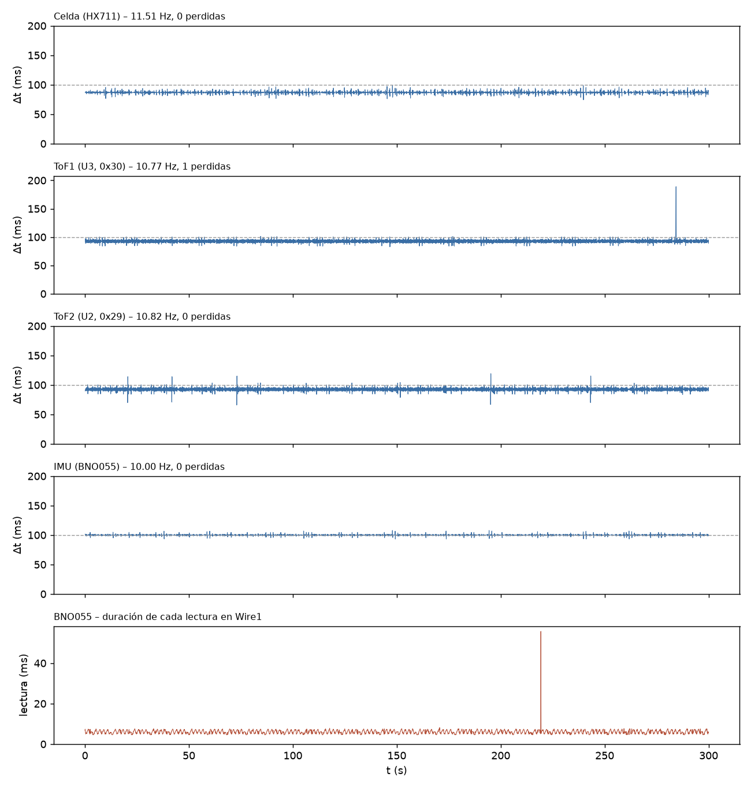

# T-INT2 – Adquisición simultánea (int2_20261110_161647)

Análisis generado el 10/11/2026 16:21. Duración registrada: 300.0 s (reloj del ESP32).

## Configuración e inicio

- `baud=115200`, `tof_periodo_ms=100`, `tof_budget_us=50000`, `imu_periodo_ms=100`, `hx711_sps_esperado=10`, `i2c_wire_hz=100000`, `i2c_wire1_hz=100000`
- `SCAN Wire (GPIO21/22, ToF): 0x29 0x30 -> esperado 0x29 0x30 : OK`
- `SCAN Wire1 (GPIO17/16, BNO055): 0x28 -> esperado 0x28 : OK`
- `INIT HX711=OK ToF1=OK ToF2=OK BNO055=OK`
- `CAL HX711 tara=1 calibrado=1 escala_N_por_cuenta=0.00024704`

## Criterios (8/13 cumplen)

Criterios propuestos para T-INT2 (ajustables en el script).

| Criterio | Resultado | Detalle |
|---|---|---|
| Lineas perdidas en el Serial = 0 | **NO CUMPLE** | 1 perdidas, 1 malformadas |
| Buffer del Serial sin bloqueos | **CUMPLE** | serialBloq = 0 |
| Celda (HX711): frecuencia real (informativo) | **INFO** | 11.51 Hz (nominal del modulo 10 Hz); dt std 1.98 ms |
| Celda (HX711): muestras perdidas <= 0.1 % | **CUMPLE** | 0 (0.000 %) en 0 huecos |
| Celda (HX711): sin errores | **CUMPLE** | 0 errores |
| ToF1 (U3, 0x30): frecuencia real (informativo) | **INFO** | 10.77 Hz (nominal del modulo 10 Hz); dt std 3.24 ms |
| ToF1 (U3, 0x30): muestras perdidas <= 0.1 % | **CUMPLE** | 1 (0.031 %) en 1 huecos |
| ToF1 (U3, 0x30): sin errores | **NO CUMPLE** | 3 errores |
| ToF2 (U2, 0x29): frecuencia real (informativo) | **INFO** | 10.82 Hz (nominal del modulo 10 Hz); dt std 3.21 ms |
| ToF2 (U2, 0x29): muestras perdidas <= 0.1 % | **CUMPLE** | 0 (0.000 %) en 0 huecos |
| ToF2 (U2, 0x29): sin errores | **NO CUMPLE** | 5 errores |
| IMU (BNO055): frecuencia dentro de +-5 % de la nominal | **CUMPLE** | 10.00 Hz vs 10.00 Hz (+0.0 %) |
| IMU (BNO055): muestras perdidas <= 0.1 % | **CUMPLE** | 0 (0.000 %) en 0 huecos |
| IMU (BNO055): sin errores | **NO CUMPLE** | 13 errores |
| IMU sin congelamientos (>= 10 s identico) | **REVISAR** | racha mas larga 72.4 s (un IMU muy quieto puede repetir valores: si sale REVISAR, mover levemente la plataforma y ver si responde) |
| Celda sin congelamiento ni saturacion | **CUMPLE** | racha identica 0.1 s, 0 muestras saturadas |

## Frecuencia real e intervalos

| Sensor | Muestras | Generadas (ESP32) | f real (Hz) | f nominal (Hz) | Δt mediana (ms) | Δt std (ms) | Δt mín / p99 / máx (ms) | Huecos | Perdidas est. |
|---|---|---|---|---|---|---|---|---|---|
| Celda (HX711) | 3454 | 3454 | 11.514 | 10.00 | 86.85 | 1.98 | 74.3 / 93.1 / 98.4 | 0 | 0 (0.000 %) |
| ToF1 (U3, 0x30) | 3231 | 3231 | 10.770 | 10.00 | 93.01 | 3.24 | 82.8 / 100.1 / 189.0 | 1 | 1 (0.031 %) |
| ToF2 (U2, 0x29) | 3246 | 3245 | 10.818 | 10.00 | 92.01 | 3.21 | 65.9 / 100.1 / 119.3 | 0 | 0 (0.000 %) |
| IMU (BNO055) | 3000 | 3000 | 10.000 | 10.00 | 100.00 | 1.23 | 93.2 / 104.6 / 107.8 | 0 | 0 (0.000 %) |

Un hueco es un intervalo mayor que 1.5× la mediana; las muestras perdidas se estiman como round(Δt / mediana) − 1 en cada hueco. Si «Generadas» supera a «Muestras», la diferencia se perdió en el enlace Serial y no en el sensor.

Huecos más largos:

- ToF1 (U3, 0x30): t = 284.16 s, Δt = 189.0 ms

## Errores y conflictos en el bus

- Líneas perdidas en el Serial (saltos del contador n): 1; líneas malformadas: 1; reinicios/desorden del contador: 0
- Bloqueos del buffer del Serial (serialBloq): 0
- Duración máxima del loop por segundo: mediana 10984 µs, p99 15332 µs, máx 55989 µs
- Errores acumulados en el ESP32: HX711 0, ToF1 3, ToF2 5, BNO055 13
  - BNO055 / lectura: 13 línea(s) E (se imprime como máximo una cada 500 ms por sensor)
  - ToF1 / i2c: 3 línea(s) E (se imprime como máximo una cada 500 ms por sensor)
  - ToF2 / i2c: 5 línea(s) E (se imprime como máximo una cada 500 ms por sensor)

## Detalle por sensor

- ToF1 – estado de rango: RangeValid 100.0 %
- ToF2 – estado de rango: RangeValid 99.8 %, SignalFail 0.2 %, 255 0.0 %
- BNO055 – duración de cada lectura (calib + Euler, Wire1): media 6048 µs, p99 7490 µs, máx 55691 µs; lecturas fallidas: 13
- BNO055 – calibración [sys,gyr,acc,mag] final [0, 3, 0, 0], mínima durante el registro [0, 2, 0, 0]
- BNO055 – racha más larga de roll/pitch/heading idénticos: 72.4 s (desde t = 36.2 s)
- HX711 – racha más larga de cuentas idénticas: 0.1 s; muestras saturadas: 0

