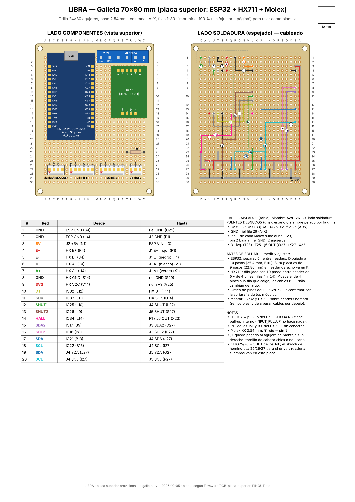
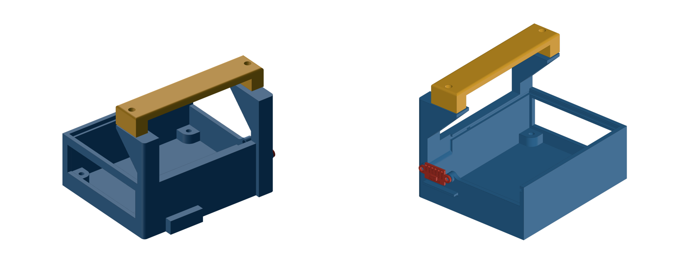
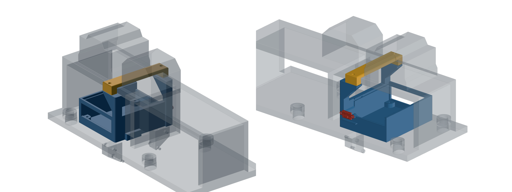

# Resumen de trabajo — Semana 10

**Período:** 17/10/2026 – 23/10/2026
**Responsable:** Alessandro Jesus Felix Tello

Foco de la semana: **terminar la placa electrónica** de la plataforma y **diseñar e imprimir en 3D la caja** que la aloja y la fija al cuerpo del simulador. Como la PCB principal todavía no se puede mandar a fabricar, la placa que se terminó es la versión provisional en galleta (perfboard) de 70×90 mm, que respeta el pinout final del diseño.

---

## 1. Placa electrónica terminada (galleta 70×90 mm)

Se completó el armado de la placa que va en la parte superior de la plataforma. Concentra en una sola tarjeta el ESP32, que es el único microcontrolador del sistema, y todas las entradas de sensores.

|  |
|---|
| Plano de armado de la galleta: lado de componentes, lado de soldadura con el cableado numerado y lista de conexiones |

**Componentes y conectores:**

| Ref. | Elemento | Función |
|---|---|---|
| U1 | ESP32-WROOM-32U DevKit (30 pines), sobre headers hembra | Microcontrolador; adquisición y envío de datos |
| U2 | Módulo HX711 (XFW-HX711), sobre headers hembra | Acondicionamiento y ADC de la celda de carga |
| J1 | Bornera KF301, 4 polos (E+, E−, A−, A+) | Entrada de la celda de carga |
| J2 | Bornera KF301, 2 polos | Alimentación de 5 V |
| J3 | Molex KK 2.54, 4 pines (3V3, GND, SDA2, SCL2) | IMU BNO055 en bus I2C dedicado (`Wire1`, GPIO17/16) |
| J4, J5 | Molex KK 2.54, 6 pines | Sensores ToF VL53L1X 1 y 2 (I2C compartido GPIO21/22; SHUT en GPIO25/26) |
| J6 | Molex KK 2.54, 3 pines | Sensor Hall del homing (GPIO34) |
| R1 | 10 kΩ | Pull-up del Hall (GPIO34 no tiene pull-up interno) |

**Detalles de armado:**
- Rieles de 3V3 y GND con puentes desnudos a lo largo de la grilla. El resto de las señales va con 20 cables aislados punto a punto en el lado de soldadura.
- El ESP32 y el HX711 van sobre headers hembra. Se pueden retirar sin desoldar y dejan pasar cables por debajo.
- Todos los sensores entran por conectores con traba (Molex KK). Esto ataca el problema de falso contacto que afectó las pruebas del BNO055 en semanas anteriores.
- Las 4 perforaciones de montaje de las esquinas coinciden con los standoffs de la caja (Secc. 2).

---

## 2. Diseño e impresión 3D de la caja de la placa

### 2.1 Requisitos
- Alojar la galleta de 90×70 mm sobre 4 standoffs (patrón 82.2×60.3 mm) y dejar 20 mm libres sobre la placa para los módulos y los conectores.
- **No perforar el cuerpo del simulador**, que es metálico. La fijación tiene que hacerse solo por presión o abrazando piezas existentes.
- Dejar salida para el USB del ESP32, las borneras y los cables de los sensores.
- Integrar el montaje de uno de los sensores ToF.

### 2.2 Proceso de diseño
Se evaluaron varias formas de anclaje antes de llegar a la versión final:
1. **Abrazadera al nervio central** del cuerpo, con contrabrida en U detrás del nervio y 2 pernos M3x25. Se descartó porque el cuerpo tiene partes soldadas que no se habían considerado en esta primera iteración y que interferían con la abrazadera.
2. **Anclaje a la placa superior** del cuerpo con clips en C, primero en las esquinas frontales y luego en las traseras, para liberar el paso de cables.
3. **Versión final (CAJAPCB):** marco de dos columnas con cartelas y una **brida superior** que pasa por encima de la placa superior del cuerpo y la prensa contra la caja con pernos M3 verticales, sin perforar nada.

### 2.3 Diseño final

|  |
|---|
| Caja de la placa (azul), brida superior (amarillo) y sensor VL53L1X en su soporte (rojo) |

|  |
|---|
| Ensamble de la caja sobre el cuerpo del simulador (en gris, transparente) |

- **Bandeja:** piso con 4 standoffs avellanados por debajo para fijar la galleta con tornillos M3.
- **Ventanas laterales** para el USB-C, las borneras y la salida de cables de los sensores.
- **Marco de anclaje:** 2 columnas con cartelas de refuerzo que suben hasta la placa superior del cuerpo. Encima va una brida de 99×20×13.5 mm con 2 agujeros M3 en los extremos, que cierra el conjunto sobre esa placa.
- **Soporte para un VL53L1X** en la pared exterior de la caja, con la cara de medición hacia fuera.
- **Medidas generales:** ~103 × 87 × 69 mm (ancho × largo × alto, contando el soporte del ToF).

### 2.4 Estado
La caja y la brida **ya están impresas**. Queda montar la galleta dentro de la caja y fijar el conjunto al cuerpo.

---

## 3. Fuentes
- `Evidencias/pcb-S10/galleta-70x90-S10.png`: plano de armado y lista de cableado de la galleta.
- `Firmware/PCB_placa_superior_PINOUT.md`: pinout de referencia de la placa superior.
- `Evidencias/caja-pcb-S10/CAJAPCB.step`: modelo 3D final de la caja, la brida y el ToF sobre el cuerpo.
- `Evidencias/caja-pcb-S10/`: vistas renderizadas del diseño final.
- `Registro-Trazabilidad.md`: cambios C-23 a C-29.
