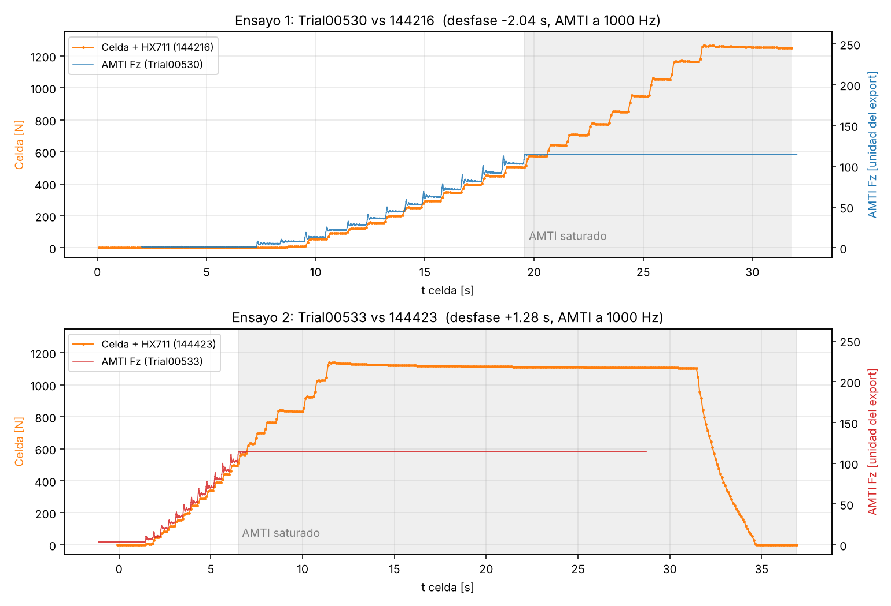
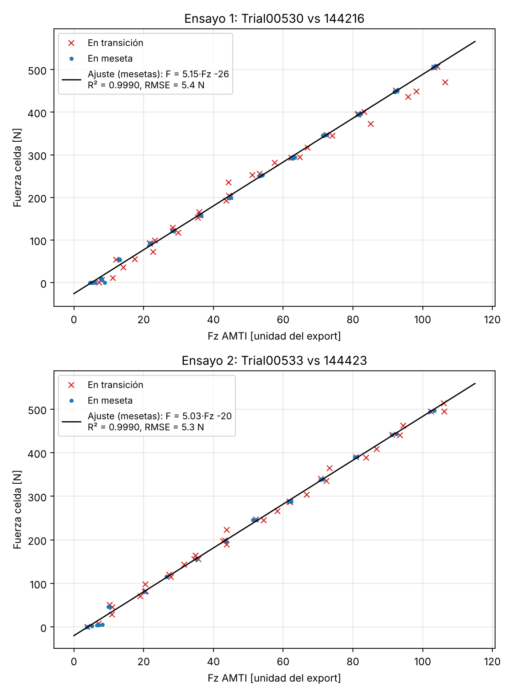
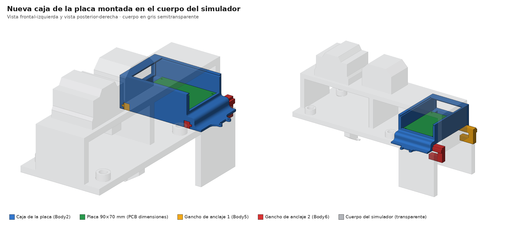
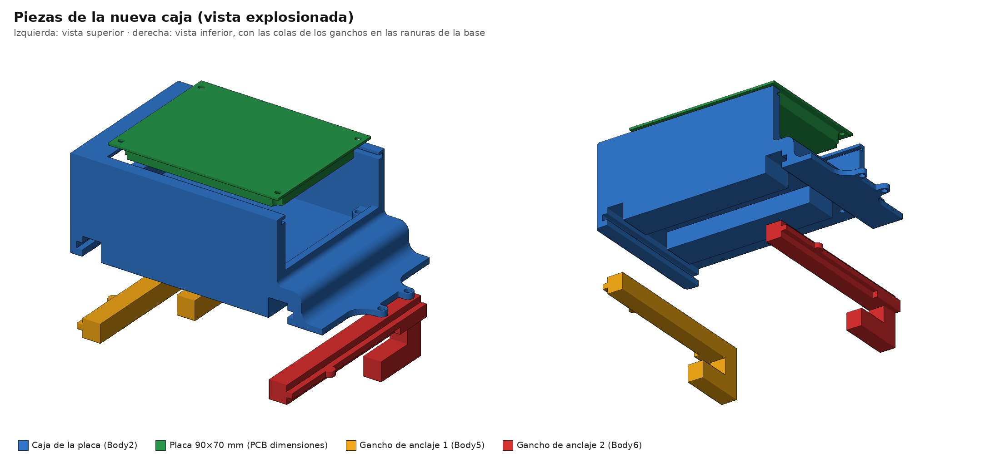

# Resumen de trabajo — Semana 11

**Período:** 24/10/2026 – 30/10/2026
**Responsable:** Alessandro Jesus Felix Tello

Foco de la semana: **primera comparación de la celda de carga contra la plataforma de fuerza AMTI**, que es la referencia del laboratorio, y **rediseño de la caja de la placa electrónica** para fijarla al cuerpo del simulador con ganchos deslizantes.

---

## 1. Comparación celda de carga + HX711 vs. plataforma AMTI

### 1.1 Preparación del software
Se agregó al visor de la celda (`visor_hx711.py`) un botón **Grabar / Detener** que guarda cada muestra en `grabaciones/hx711_<fecha>_<hora>.csv` con la **hora de la PC** tomada en el momento en que llega la línea por el puerto serie (no en el redibujado de la gráfica). Con esa marca de tiempo se puede alinear el registro de la celda con el de otro equipo que graba en paralelo, en este caso la AMTI.

Columnas del CSV: `pc_time_iso, pc_time_unix_s, t_rel_s, raw_code, force_N, tared, calibrated`.

### 1.2 Ensayo
- **Fecha:** 27/10/2026, 14:42–14:46.
- **Montaje:** la celda (tipo fuelle, 220 lb) sobre la plataforma AMTI, de modo que ambas reciben la misma carga axial. La carga se aplicó **en escalones** y se mantuvo unos segundos en cada uno (mesetas).
- **Adquisición:** celda + HX711 a ~11.5 Hz (calibración de la S7, 0.001098 N/cuenta); AMTI a 1000 Hz.
- **Registros:** 5 archivos de la celda. Se usaron dos ensayos completos, cada uno con su archivo de la AMTI:

| Ensayo | Celda (HX711) | AMTI | Duración | Fuerza máx. en la celda | Desfase de alineación |
|---|---|---|---|---|---|
| 1 | `hx711_20261027_144216.csv` | Trial00530 | 31.7 s | ~1270 N | −2.04 s |
| 2 | `hx711_20261027_144423.csv` | Trial00533 | 37.0 s | ~1140 N | +1.28 s |

Los otros tres archivos (`144358`, `144413`, `144540`) son tomas cortas o de prueba y no entran en el análisis.

### 1.3 Resultados

|  |
|---|
| Fuerza de la celda (naranja, eje izq.) y Fz de la AMTI (eje der.) alineadas en el tiempo. La zona gris es donde la AMTI ya estaba saturada |

|  |
|---|
| Fuerza de la celda contra Fz de la AMTI, muestra a muestra. Azul: puntos en meseta (usados en el ajuste); rojo: puntos en transición |

Ajuste lineal usando solo las mesetas (la carga estable), en el rango donde la AMTI no estaba saturada:

| Ensayo | Ajuste | R² | RMSE |
|---|---|---|---|
| 1 | F_celda = 5.15 · Fz_AMTI − 26 | 0.9990 | 5.4 N |
| 2 | F_celda = 5.03 · Fz_AMTI − 20 | 0.9990 | 5.3 N |

**Lectura de los resultados:**
- La celda sigue a la AMTI de forma **lineal** en todo el rango comparable (0 a ~550 N en la celda), con R² = 0.999 en ambos ensayos y un error de ~5 N.
- La pendiente es **repetible** entre ensayos (5.15 y 5.03, diferencia de ~2 %).
- Los puntos en transición se alejan de la recta. Es lo esperado: la celda muestrea a ~11.5 Hz y la AMTI a 1000 Hz, así que en los cambios bruscos de carga no se capturan en el mismo instante. Por eso el ajuste se hizo solo con las mesetas.
- La AMTI **se saturó** a partir de ~115 unidades del export (≈ 580 N en la celda). Desde ese punto solo la celda registró la carga, que llegó hasta ~1270 N.

### 1.4 Observaciones y pendientes
- **Unidad del export de la AMTI:** la Fz quedó en una unidad que no se confirmó en el software de adquisición. Hay que verificarla para convertir la pendiente a una ganancia N/N. Si fuera lbf (4.448 N/lbf), la celda estaría leyendo ~13–16 % por encima de la AMTI y convendría revisar la calibración con varias masas patrón.
- **Saturación de la AMTI:** hay que revisar el rango o la ganancia configurados en el amplificador antes de repetir, para comparar en todo el rango de carga de la marcha.
- **Carga sobre la nominal:** en ambos ensayos la celda pasó su capacidad nominal (220 lb ≈ 978 N), hasta ~130 %. Se recomienda limitar los próximos ensayos a la capacidad nominal y revisar que el cero no haya cambiado.
- **Sincronización:** el desfase entre equipos se corrigió a mano (−2.04 s y +1.28 s). Para los próximos ensayos conviene un evento de sincronización al inicio (p. ej. un golpe corto de carga) que quede marcado en ambos registros.

---

## 2. Rediseño de la caja de la placa (nuevoPCB)

Se rehízo la caja de la placa electrónica. La nueva versión es más baja, se apoya sobre la placa base del cuerpo y se fija con **dos ganchos deslizantes**, sin pernos al cuerpo y sin perforarlo.

|  |
|---|
| Nueva caja (azul) con la placa (verde) y los dos ganchos de anclaje (amarillo y rojo), montada en el cuerpo del simulador (gris, transparente) |

|  |
|---|
| Vista explosionada: la placa sale por arriba y los ganchos por abajo. A la derecha, vista inferior con las ranuras de la base donde entran los ganchos |

**Piezas:**

| Pieza | Medidas aprox. | Descripción |
|---|---|---|
| Caja de la placa | 148 × 81 × 49 mm (con el ala de salida) | Bandeja abierta por arriba para la placa de 90 × 70 mm. Ranuras en la parte alta de las paredes para una tapa deslizante. En un extremo tiene un ala con un canal curvo para la salida de cables y 2 orejas con agujero. En la base tiene dos ranuras con perfil en T para los ganchos |
| Gancho de anclaje 1 y 2 | 102 × 30 × 15 mm c/u | Barra con cola en T que entra por la ranura de la base de la caja y termina en un gancho en C que abraza el borde de la placa base del cuerpo |
| Placa | 90 × 70 mm | Placa electrónica (la galleta provisional o la PCB final, que comparten dimensiones y patrón de agujeros) |

**Ventajas frente a la caja de la S10:**
- Menos piezas y sin brida superior: la caja queda fija con dos ganchos que se deslizan en su base.
- Sigue sin perforar el cuerpo metálico.
- Más baja, con la placa accesible desde arriba y la salida de cables guiada por el ala lateral.

**Estado:** diseño 3D terminado. Falta imprimirlo y probar el ajuste de los ganchos sobre la placa base.

---

## 3. Fuentes
- `Firmware/test_hx711/visor_python/visor_hx711.py`: visor con grabación a CSV y marca de tiempo de la PC.
- `Firmware/test_hx711/visor_python/grabaciones/`: registros de la celda del 27/10.
- `Evidencias/pruebas-fuerza-amti-S11/`: gráficos de la comparación con la AMTI.
- `Evidencias/caja-pcb-S11/nuevoPCB.step`: modelo 3D de la nueva caja sobre el cuerpo.
- `Evidencias/caja-pcb-S11/`: vistas renderizadas de la nueva caja.
- `Registro-Trazabilidad.md`: cambios C-30 y C-31, prueba P-18.
