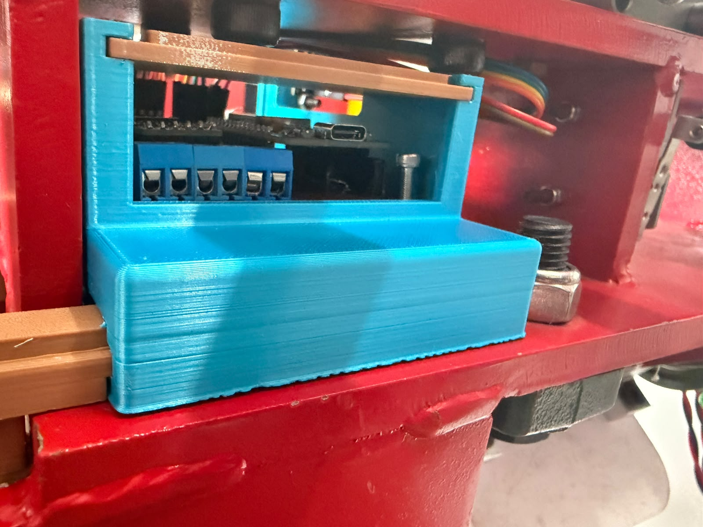
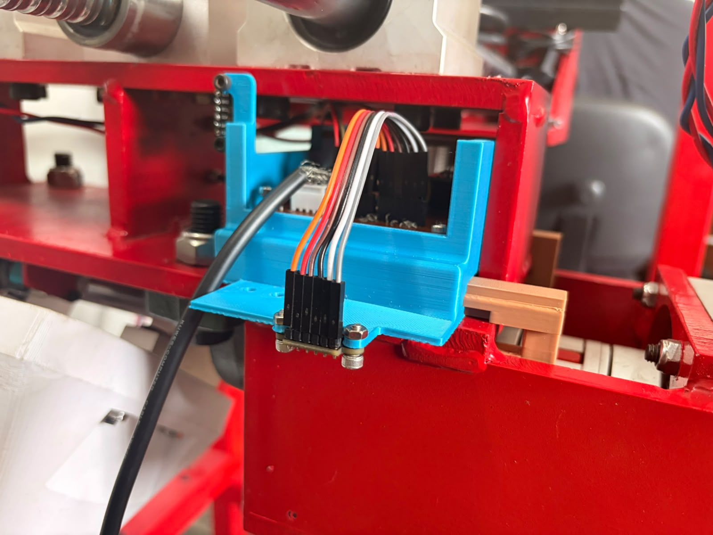
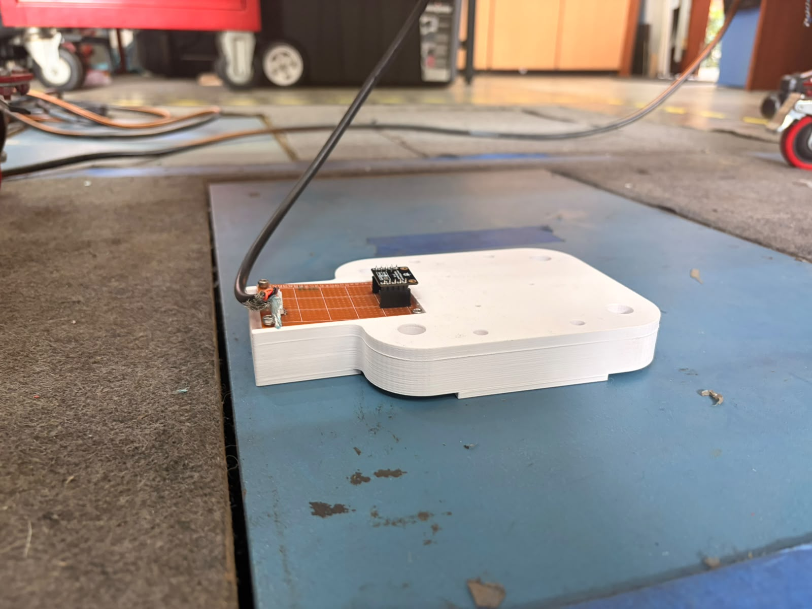

# Resumen de trabajo — Semana 12

**Período:** 31/10/2026 – 06/11/2026
**Responsable:** Alessandro Jesus Felix Tello

Foco de la semana: **integración física de los sensores en el cuerpo del simulador** (caja de la placa, IMU y sensores de distancia), con los ajustes de holguras que pidió el montaje real, y **definición de las pruebas de validación** de cada sensor. La comparación con la AMTI no se pudo repetir porque el simulador estuvo ocupado en la implementación del control.

---

## 1. Integración física de los sensores

### 1.1 Caja de la placa montada en el cuerpo
Se imprimió la caja de la S11 (nuevoPCB) y se montó sobre la placa base del cuerpo con los dos ganchos deslizantes. La galleta 70 × 90 queda dentro, con las borneras y el USB-C accesibles por la ventana lateral. Se agregó una tapa deslizante con seguro por resalte elástico (C-32), que cierra la caja sin tornillos.

|  |
|---|
| Caja de la placa (azul) montada en el cuerpo del simulador. Los ganchos (marrón) entran por la base y abrazan la placa base, sin perforar el cuerpo |

### 1.2 Sensor de distancia (VL53L1X)
El VL53L1X se fijó en un soporte impreso que sale de la caja, conectado a la galleta con un cable de 6 hilos. La posición se eligió para que la distancia al objetivo **no baje nunca de ~40 mm**, el límite inferior del rango útil del sensor. Así, en todo el recorrido del mecanismo, el ToF trabaja dentro de su rango y no entrega lecturas fuera de rango en el punto más cercano.

|  |
|---|
| VL53L1X fijado con dos pernos al soporte de la caja, cableado a la galleta |

### 1.3 IMU (BNO055)
El BNO055 quedó montado sobre su placa perforada en la pieza inferior de la plataforma, con su cable blindado hacia la galleta (conector Molex con traba, bus `Wire1`). Se modeló el recorrido del cable en el ensamble general para verificar que no interfiere con las partes móviles.

|  |
|---|
| BNO055 montado en la pieza inferior de la plataforma, con la salida de cable |

### 1.4 Corrección del roll en el firmware
Se aplicó en el ESP32 el filtro de corrección lineal del roll obtenido en la S9 con el soporte de arco (26 puntos, 0–60°):

`roll_corregido = (roll_medido − (−0.514)) / 0.9697`

La corrección se aplica sobre el roll filtrado (EMA) antes de restar el cero, que es la misma señal con la que se hizo el ajuste. La línea que envía el ESP32 agrega dos campos al final: `RollCorr` (roll corregido) y `RollCorrAbs` (corregido y relativo al cero guardado). El campo `Euler[...]` se mantiene sin corregir, para que las próximas pruebas de calibración registren la lectura original y se pueda reajustar la recta. Las constantes son preliminares hasta completar T-IMU2 y T-IMU3.

### 1.5 Ajustes de holguras
Durante el montaje se ajustaron holguras de las piezas impresas para que entren sobre el cuerpo real (partes soldadas, tolerancia de la impresión). Las piezas quedaron montadas sin forzar y sin perforar el cuerpo metálico.

---

## 2. Definición de las pruebas de validación

Con los sensores ya en su posición final, se definieron las pruebas para la siguiente etapa. Todas se registran en `Registro-Trazabilidad.md` con su configuración vigente y con un commit del firmware antes de cada tanda.

### 2.1 Sensores de distancia (VL53L1X)

| ID | Prueba | Procedimiento | Qué se obtiene | Criterio |
|---|---|---|---|---|
| T-ToF1 | Exactitud estática en el montaje final | Bloques o separadores de altura conocida (verificados con vernier) entre el sensor y el objetivo, cubriendo el recorrido real: p. ej. 40, 50, 60, 80, 100 mm y el máximo del recorrido. 3 repeticiones por punto, en orden aleatorio, 20 s cada una, descartando los primeros 2 s | Sesgo y desviación estándar por punto; ajuste lineal medido vs. real (pendiente, offset, R²) | Error tras la corrección dentro de lo que pida la medición (proponer ±2 mm) |
| T-ToF2 | Comportamiento cerca del mínimo | Registrar a 45, 40, 35 y 30 mm con el estado de rango (`range_status`) que reporta el sensor | Dónde empieza a fallar la lectura en este montaje | Confirmar que el punto más cercano real tiene margen sobre ese límite |
| T-ToF3 | Superficie del objetivo | Repetir dos puntos de T-ToF1 sobre la superficie real (metal pintado) y sobre una superficie mate de referencia | Efecto del color/reflectancia | Diferencia menor al error aceptado; si no, calibrar sobre la superficie real |
| T-ToF4 | Interferencia entre los dos ToF | Mismo punto con un solo sensor activo y luego con ambos | Si un sensor perturba al otro | Sin cambio significativo en media ni en desviación |
| T-ToF5 | Estabilidad en el tiempo | Sensor quieto 10 min | Deriva por calentamiento | Deriva menor que la desviación de T-ToF1 |
| T-ToF6 | Seguimiento dinámico | Mover el mecanismo entre posiciones conocidas (o a velocidad constante) y comparar contra la referencia disponible (vernier en los extremos, Hall/husillo) | Retardo y error en movimiento a ~10 Hz | Seguir los cambios sin saltos ni pérdidas de datos |

### 2.2 IMU (BNO055)

| ID | Prueba | Procedimiento | Qué se obtiene | Criterio |
|---|---|---|---|---|
| T-IMU1 | Ruido en reposo, montaje final | IMU quieto en 0°, 3 tomas de 60 s tras 30 s de asentamiento. Descartar tomas con std = 0 (señal congelada) | Desviación estándar de roll/pitch y estado de calibración | Mismo orden que con el conector bien puesto (std < 0.1°) |
| T-IMU2 | Exactitud angular | 0/10/20/30° con cuñas o inclinómetro de referencia, ≥3 repeticiones por ángulo en orden aleatorio | Recta medido vs. real con IC (sobre `Euler[...]`, sin corregir); comparar con la recta de la S9 (0.9697·real − 0.514°) que usa el firmware | Ajuste repetible; error residual < 0.5° |
| T-IMU3 | Validación de la corrección | Con la corrección del firmware (`RollCorrAbs`) en una sesión independiente (otro día) | Error residual con la corrección fija | Error residual < 0.5° |
| T-IMU4 | Vibración del simulador | Mismo ángulo con el simulador apagado y en marcha | Aumento del ruido por el motor y la estructura | Definir el filtrado necesario si el ruido sube |
| T-IMU5 | Retorno al cero | Llevar la plataforma a un ángulo y volver al cero 5 veces | Repetibilidad del cero | Diferencia < 0.5° entre retornos |

### 2.3 Integración de todos los sensores en la galleta

| ID | Prueba | Procedimiento | Qué se obtiene |
|---|---|---|---|
| T-INT1 | Verificación eléctrica | Continuidad, alimentación de 3.3 V y 5 V en cada conector y escaneo I2C (`Wire`: ToF 0x29/0x30; `Wire1`: BNO055) | Que todos los sensores respondan en la galleta |
| T-INT2 | Adquisición simultánea | Celda, ToF e IMU leyendo a la vez durante 5 min | Frecuencia real de cada sensor, muestras perdidas y conflictos en el bus |

### 2.4 Sincronización con la AMTI

El problema de la S11 fue que los dos equipos no comparten reloj y el desfase se corrigió a mano. Se evaluarán estas opciones, en orden de preferencia:

1. **Leer la salida analógica de la AMTI con el ADS1256.** Si el amplificador de la AMTI tiene salidas analógicas de Fz, se lee esa señal con el ADS1256 en el mismo sistema que adquiere los demás sensores. Todo queda con el mismo reloj y no hace falta alinear. Hay que verificar el rango de salida del amplificador (suele ser de ±10 V) y adaptarlo a la entrada del ADS1256 con un divisor o un acondicionador.
2. **Pulso de disparo compartido.** El ESP32 (o la Raspberry) genera un pulso digital al empezar a grabar. El mismo pulso entra a la entrada de sincronización o a un canal auxiliar del sistema de la AMTI y queda marcado en los dos registros. Hay que confirmar qué entradas tiene el equipo.
3. **Evento mecánico de sincronización.** Un golpe corto de carga al inicio de cada registro, visible en la celda y en la AMTI. No requiere hardware extra y sirve de respaldo, pero su precisión queda limitada por los ~11.5 Hz de la celda (~90 ms).

---

## 3. Dificultades

- **AMTI no disponible:** el simulador se usó toda la semana para implementar el control, así que no se pudo repetir la comparación de la celda con la AMTI. Se pasa a la próxima semana, coordinando el uso del simulador.
- **Holguras de las piezas impresas:** el montaje sobre el cuerpo real obligó a ajustar holguras de las piezas.

---

## 4. Pendientes para la siguiente semana

- Usar la AMTI: confirmar la unidad del export, revisar el rango del amplificador y repetir la comparación de la celda con un método de sincronización (sección 2.4).
- Verificación eléctrica de la galleta y adquisición simultánea de todos los sensores (T-INT1, T-INT2).
- Medir con los sensores de distancia y el IMU en su posición final (T-ToF1 a T-ToF3, T-IMU1 y T-IMU2).

---

## 5. Fuentes
- `Evidencias/integracion-sensores-S12/`: fotos del montaje de la caja, el ToF y el IMU.
- `Claude outputs/cajaPCB_v3_snap/`: tapa deslizante con seguro (C-32).
- `Claude outputs/cable_imu/Cable_IMU.step` y `Claude outputs/EnsambleFinalFinal_con_cable.step`: recorrido del cable del IMU en el ensamble.
- `Firmware/test_tof/`: firmware de los dos VL53L1X.
- `Firmware/test_wifi_ap_bno055/test_wifi_ap_bno055.ino`: corrección del roll (`corregirRoll()`, campos `RollCorr` y `RollCorrAbs`).
- `Registro-Trazabilidad.md`: cambios C-32 a C-35.
