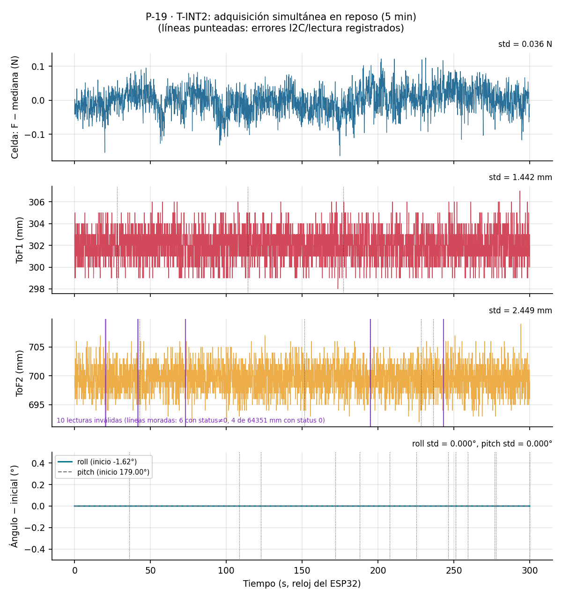
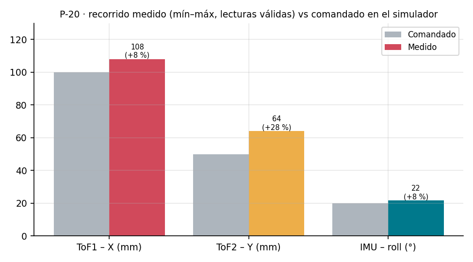
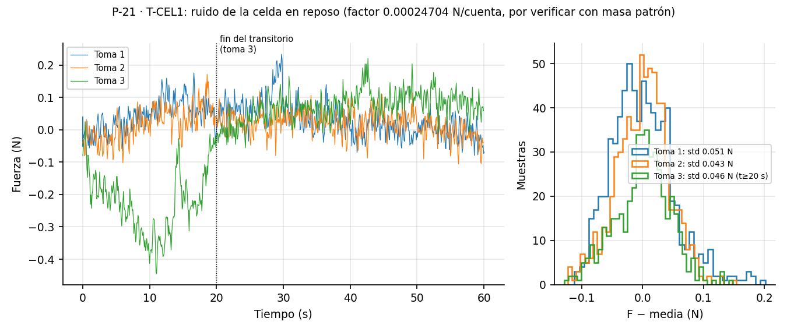
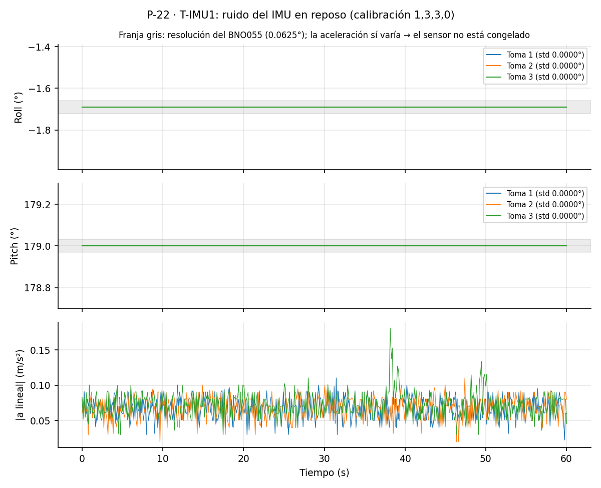
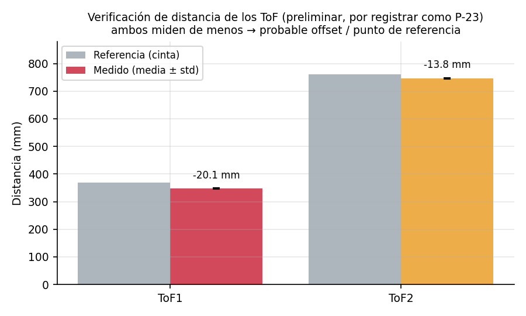

# Resumen de trabajo — Semana 13

**Período:** 07/11/2026 – 13/11/2026
**Responsable:** Alessandro Jesus Felix Tello

Foco de la semana: **primera adquisición simultánea de todos los sensores en la galleta** (celda con HX711, dos VL53L1X y BNO055), en reposo y con el simulador en movimiento, y **primeras pruebas de validación en el montaje final** (ruido de la celda y del IMU, verificación de distancia de los ToF). En el camino se encontró y corrigió un problema de lecturas corruptas del BNO055.

---

## 1. Adquisición simultánea de los sensores

### 1.1 Firmware y registro (C-36)
Los sketches de cada sensor leían bloqueando, así que no servían para medir los tres a la vez. Se escribió `test_integracion_sensores.ino`, que lee sin bloqueo:

- HX711 cuando `is_ready()` indica dato nuevo (~11.5 Hz).
- Los dos VL53L1X consultando `dataReady()` cada 5 ms (periodo de 100 ms, budget de 50 ms), en el bus `Wire` (GPIO21/22).
- El BNO055 cada 100 ms, en el bus `Wire1` (GPIO17/16), ambos buses a 100 kHz.

Cada muestra lleva `micros()` y un contador de líneas, y el firmware cuenta los errores por sensor (error de I2C, sin datos por más de 500 ms, lectura fallida), el loop más largo y los bloqueos del Serial. Al arrancar escanea los dos buses I2C. En la PC, `log_integracion.py` registra la sesión y calcula la frecuencia real de cada sensor, los huecos, las muestras y líneas perdidas, con un resumen y una gráfica. Para las pruebas en movimiento se agregó `visor_integracion.py`, con visualización en vivo y botón Grabar.

Criterios fijados antes de medir: 0 líneas perdidas y 0 errores; ToF e IMU dentro de ±5 % de su frecuencia nominal; ≤ 0.1 % de muestras perdidas; la frecuencia de la celda se reporta como informativa (~11.5 Hz).

En la galleta se agregaron pull-ups de 4.7 kΩ en SDA2/SCL2 (bus del BNO055).

### 1.2 Prueba en reposo, 5 min (P-19, T-INT2)
Galleta sobre la plataforma, quieta y sin carga en la celda; 10 s descartados + 300 s de registro por USB a 115200 baudios.

| Sensor | Frecuencia real | Muestras perdidas | Errores |
|---|---|---|---|
| Celda (HX711) | 11.51 Hz | 0 | 0 |
| ToF1 | 10.77 Hz | 1 (0.03 %) | 3 (I2C, se recuperan solos) |
| ToF2 | 10.82 Hz | 0 | 5 (I2C, se recuperan solos) |
| IMU (BNO055) | 10.00 Hz | 0 | 13 (0.43 %, descartadas) |

- Se cumplieron **8 de 13 criterios**. Los que no se cumplen son los de "0 errores" (los errores existen, pero ninguno deja pasar un valor corrupto como válido) y la frecuencia de los ToF, que sale ~8 % por encima de la nominal porque el oscilador interno del VL53L1X va rápido; ese criterio pasa a ser informativo.
- Serial: 1 línea corrupta en 5 min, ningún bloqueo. Loop máximo de 56 ms una sola vez (una lectura I2C que esperó hasta el timeout).
- IMU sin deriva en 5 min (roll −1.62° y pitch 179.00° constantes). Un intento previo mostró una deriva de ~1.1° en roll que no se repitió; se atribuye a que la plataforma se asentó, ya que no queda fija entre pruebas.

|  |
|---|
| P-19: señales de los cuatro sensores durante los 5 min en reposo |

### 1.3 Prueba en movimiento con el simulador (P-20)
Mismo firmware, con el simulador moviendo la plataforma: X 10 cm, Y 5 cm (bajada y subida) e inclinación −20° ↔ 0°; 90 s de registro. No hay log de posición del simulador, así que se comparan los recorridos extremos.

| Sensor | Comandado | Medido | Diferencia |
|---|---|---|---|
| ToF1 (X) | 100 mm | 108 mm (345–453 mm) | +8 % |
| ToF2 (Y) | 50 mm | 64 mm (691–755 mm) | +28 % |
| IMU (roll) | 20° | 21.6° (−22.8° ↔ −1.2°) | +8 % |

- Los tres sensores siguen el movimiento, sin congelamientos y sin líneas perdidas en el Serial (9/13 criterios).
- El desfase de ~−1.2° del roll en 0° es del orden de lo que corrige `corregirRoll()` (C-35).
- El ToF2 mide un recorrido 28 % mayor que el comandado: hay que revisar la geometría del objetivo en Y y su calibración.
- Los errores de los ToF suben a ~4.7/min frente a ~1.6/min en reposo, compatible con el cable en movimiento; con 90 s de registro todavía es poca evidencia.

|  |
|---|
| P-20: recorrido medido por cada sensor frente al comandado en el simulador |

---

## 2. Lectura verificada del BNO055 (C-38)

Durante la integración se vio que, con el core ESP32 3.3.12, ~1–2 % de las lecturas de 6 bytes del BNO055 (`getEul()`, `getAxis()`) llegaban corruptas y **pasaban como válidas**. Se cambió la lectura en los dos firmwares (`test_integracion_sensores.ino` y `test_wifi_ap_bno055.ino`):

- Cada eje se lee en su propia transacción de 2 bytes.
- Un valor se acepta solo si dos lecturas seguidas coinciden (hasta 3 intentos).
- Si la muestra no se verifica, no se envía ni entra al filtro EMA; lo mismo para el cero y el calentamiento del filtro.

El formato de salida no cambia. Como costo, la línea del IMU en `test_wifi_ap_bno055.ino` sale a ~7.8 Hz en vez de ~9.7 Hz. Tras el cambio, en P-19 y P-20 ningún valor corrupto pasó como válido: las lecturas fallidas quedan marcadas con `ok=0` y se descartan.

---

## 3. Pruebas de validación en el montaje final

### 3.1 Ruido de la celda en reposo (P-21, T-CEL1)
Celda sin carga montada en la galleta, tara justo antes, 3 tomas de 60 s a ~11.5 Hz.

- Desviación estándar: **0.051 / 0.043 / 0.046 N** (207 / 174 / ~185 cuentas). En la toma 3 hubo un transitorio en los primeros ~20 s; desde ahí, 0.046 N.
- Promedios: 0.032 / 0.017 / −0.026 N.
- **Pendiente importante:** el factor guardado en el ESP32 (0.00024704 N/cuenta) es distinto del obtenido en la S7 con la masa patrón (0.001098 N/cuenta). Con el factor de la S7 el ruido sería ~0.2 N. Hay que verificar el factor con la masa patrón antes de usar la celda para comparar contra la AMTI.

|  |
|---|
| P-21: ruido de la celda en reposo, 3 tomas de 60 s |

### 3.2 Ruido del IMU en reposo (P-22, T-IMU1)
IMU en 0°, 30 s de asentamiento y 3 tomas de 60 s con el firmware de lectura verificada.

- Desviación estándar de roll y pitch: **0.0000°** en las tres tomas, por debajo de la resolución del BNO055 (0.0625°). Cumple el criterio (< 0.1°).
- Para descartar una señal congelada se comprobó que la aceleración sí variaba (std 0.007–0.017 m/s²) y se inclinó la plataforma 20°: el roll cambió 19.37° sin corregir y **19.98° con `corregirRoll()`**.
- Ajuste al procedimiento: la regla "std = 0 → descartar" no distingue una señal congelada de un ruido menor que la resolución; se reemplaza por "std = 0 → verificar moviendo el sensor".

|  |
|---|
| P-22: roll y pitch en reposo, 3 tomas de 60 s |

### 3.3 Verificación de distancia de los ToF (P-23, preliminar)
Un punto por sensor, comparando contra una medición con cinta:

| Sensor | Referencia (cinta) | Medido (media ± std) | Diferencia |
|---|---|---|---|
| ToF1 | 368.3 mm | 348.2 ± 1.5 mm | −20.1 mm (−5.5 %) |
| ToF2 | 760.0 mm | 746.2 ± 2.3 mm | −13.8 mm (−1.8 %) |

Los dos sensores miden de menos. Con un solo punto no se puede separar un offset (por ejemplo, el punto desde el que se midió con la cinta o la cara del objetivo) de un error de ganancia; para eso está T-ToF1 con varios puntos medidos con vernier.

|  |
|---|
| P-23: distancia medida por cada ToF frente a la referencia |

---

## 4. Soporte del segundo ToF (C-37)
Para la prueba de interferencia entre los dos sensores (T-ToF4) se diseñó una escuadra que se fija con 2 pernos M3×16 a los agujeros libres de la repisa de la caja. Lleva una copia exacta del asiento del ToF1, de modo que las dos placas quedan en el mismo plano y a ~30 mm entre sí. Sin interferencias con la caja en el ensamble; queda por imprimir.

|  |
|---|
| Soporte del ToF2 sobre la repisa de la caja |

---

## 5. Dificultades

- **Lecturas corruptas del BNO055:** ~1–2 % de las lecturas de 6 bytes llegaban mal y pasaban como válidas. Se resolvió con la lectura verificada eje por eje (sección 2), a costa de bajar la frecuencia del IMU de ~9.7 a ~7.8 Hz en el firmware de la plataforma.
- **Factor de calibración de la celda:** el factor que tiene el ESP32 no coincide con el de la S7 y no hay registro de cuándo se obtuvo. Hasta verificarlo, los valores en N de la celda son provisionales.
- **Comparación con la AMTI:** no se repitió esta semana; sigue pendiente junto con la sincronización.

---

## 6. Pendientes para la siguiente semana

- Verificar el factor de la celda con la masa patrón y dejarlo registrado.
- T-ToF1 completo (varios puntos con vernier) para separar offset y ganancia de los ToF; revisar el recorrido del ToF2 en Y.
- Imprimir el soporte del ToF2 y hacer T-ToF4 (interferencia entre los dos sensores).
- T-IMU2: exactitud angular a 0/10/20/30° con referencia, comparando contra la recta de la S9.
- AMTI: confirmar la unidad del export, definir la sincronización y repetir la comparación de la celda sin saturar.
- Repetir la prueba en movimiento con un registro más largo para confirmar la tasa de errores de los ToF.

---

## 7. Fuentes
- `Firmware/test_integracion_sensores/`: firmware de adquisición simultánea, `log_integracion.py` y `visor_integracion.py` (commit `ebf604c`).
- `Firmware/test_wifi_ap_bno055/test_wifi_ap_bno055.ino`: lectura verificada del BNO055 (C-38).
- `Evidencias/integracion-sensores-S13/`: registros de P-19 (`int2_20261110_161647_*`) y P-20 (`integracion_20261110_165539_*`), con resumen y gráfica de intervalos.
- `Evidencias/pruebas-fuerza-S13/` (P-21) y `Evidencias/pruebas-imu-S13/` (P-22).
- `Evidencias/graficos-S13/`: gráficos de esta semana y `generar_graficos_S13.py`.
- `Claude outputs/soporte_tof2/`: soporte del ToF2 (C-37).
- `Registro-Trazabilidad.md`: cambios C-36 a C-38 y pruebas P-19 a P-23.
